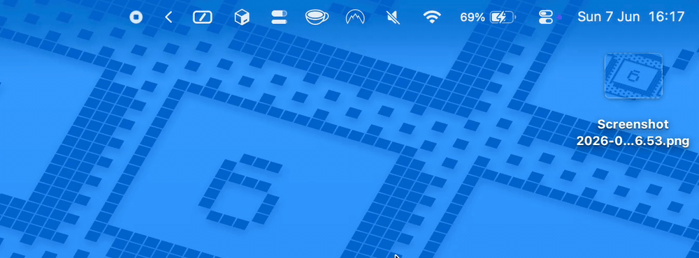

# Nexus

<p align="center">
  
</p>


Nexus (天枢) is a native macOS menu-bar utility for copying paths, inspecting file-copy activity, and viewing keyboard/mouse usage statistics. Optional network synchronization is available for usage statistics.

Drop something on the menu bar icon, then paste the path wherever you need it.



## Why

Nexus provides a faster way to copy file paths without switching applications.

Copying a path traditionally means switching between Finder, Terminal, or a context menu. Nexus reduces that work to a menu-bar drop or a direct Finder action, with a separate view for copy-operation history.

Nexus removes that detour:

1. Drag a file or folder.
2. Drop it on the Nexus menu bar icon.
3. Paste the copied path.

No command palette, no temporary shelf, and no extra window to manage.

## Features

- **Menu bar drop target**: drop files or folders directly on the Nexus icon.
- **Finder Copy Path**: right-click selected files or folders in Finder and choose **Copy Path**.
- **Instant clipboard copy**: the formatted path is copied as soon as the drop succeeds.
- **Multiple path formats**:
  - Shell Escaped
  - Path
  - Quoted Path
  - File URL
  - Home-relative Path
- **Multi-item support**: drop more than one item and Nexus formats the full set for the selected output style.
- **Recent paths and operation timeline**: reuse recently copied paths and inspect recorded file-copy operations.
- **Input statistics**: view local keyboard, mouse, and system-key usage counts when the required system permissions are granted.
- **File-copy monitoring**: optionally record copied file URLs and related metadata.
- **Network statistics sync**: optionally connect to a Nexus-compatible server to upload, query, and restore supported input statistics.
- **Drop feedback**: quick visual confirmation when a path was copied.
- **Launch at login**: keep Nexus ready without starting it manually.
- **Sparkle updates**: release builds include update checking support.

## How It Works

Nexus lives in the macOS menu bar. Click the icon to change the output format, copy recent paths again, open Settings, or quit. Launch-at-login, Finder integration, updates, and app information live in the Settings window.

The bundled Finder extension adds a copy command named for the selection, such as **Copy Folder Path** or **Copy PDF document Path**. It copies the full path in the **Copy As** format selected in Nexus. Open **Settings… → Finder** to put Nexus’s commands in a submenu or manage the Finder extensions registered on your Mac.

**简体中文使用说明**

将 Nexus 拖入「应用程序」并打开。点击菜单栏的 Nexus 图标，选择「设置…」→「访达」→「打开系统扩展设置…」，在系统设置中启用 Nexus 的访达扩展。扩展随应用提供。

「访达」设置页可刷新本机扩展列表、逐项启用或停用扩展，也可将 Nexus 的拷贝命令统一放进同名子菜单。右键单个文件时，菜单会尽量显示系统提供的文件类型名称，例如「拷贝 PDF 文稿路径」。

默认在访达一级右键菜单显示拷贝命令。iCloud 云盘等位置是否显示该命令取决于访达是否在该目录加载扩展。

The default workflow is intentionally small:

```text
Drop file -> copy path -> paste path
```

That makes it useful for developers, designers, QA, support, and anyone else who repeatedly sends local file references to terminals, scripts, docs, chats, or AI tools.

## Get Nexus

- macOS 13 or newer
- Website: [nexus.app](https://github.com/qssedalto/Nexus/)

Nexus has not yet published an official signed release. Check [GitHub Releases](https://github.com/qssedalto/Nexus/releases) for builds when they become available.

The zip asset is used for Sparkle automatic updates.

## Build Locally

Local builds are meant for development and testing. They create a separate `Nexus Dev.app`, so you can run it without sharing settings or history with the eventual production app.

Requirements:

- macOS 13 or newer
- Xcode 26 or newer
- [XcodeGen](https://github.com/yonaskolb/XcodeGen) 2.46 or newer (`brew install xcodegen`)
- An Apple Development signing identity for running the Finder extension

`project.yml` is the source of truth for the Xcode project. Generate it manually with:

```bash
./Scripts/generate_project.sh
```

Build and verify the side-by-side dev app:

```bash
./Scripts/build_and_run.sh --verify --test
```

Run it locally:

```bash
./Scripts/build_and_run.sh
```

The dev build packages as `Nexus Dev.app` with bundle identifier `com.qssedalto.nexus.dev`, separate settings/history, Sparkle disabled, a `DEV` menu bar label, and a dev-badged app icon. When launched, the script signs it with an Apple Development identity, installs it to `~/Applications`, registers the Finder extension from that stable location, and opens the installed copy. Set `DEV_APP_IDENTITY` or `DEV_INSTALL_DIR` in `.env` to override those defaults.

Run the full SwiftPM and Xcode test suite with:

```bash
./Scripts/test.sh
```

## Development Gate

Run the local CI gate:

```bash
./ci.sh
```

## License

Nexus modifications © 2026 qssedalto. Upstream portions © 2026 Marco Gomiero; see [NOTICE.md](NOTICE.md).

Nexus retains Apache-2.0 licensing for its upstream portions and contributions are licensed under the Apache License, Version 2.0. See [LICENSE](LICENSE) for the full license text.

## GitHub Actions builds and development signing

Open [Build Nexus.app (macOS Apple Silicon)](https://github.com/qssedalto/Nexus/actions/workflows/build-nexus.yml), then choose **Run workflow**.

- **development** (the manual default): produces `Nexus Dev.app`, bundle ID `com.qssedalto.nexus.dev`, signed with the Apple Development identity from the imported P12. This is for development/testing and does not replace `Nexus.app`.
- **push to `main` (automatic)**: uses the Apple Development P12 from repository Secrets, producing `Nexus.app` with bundle ID `com.qssedalto.nexus`. Its updater is disabled when no Sparkle release key is configured. This is an **unnotarized development-signed test artifact**, not a Developer ID release.
- **adhoc** (manual opt-in): produces `Nexus.app` with Ad Hoc signing, without needing an Apple certificate. Automatic pushes no longer fall back to Ad Hoc signing.
- Both builds archive the `.app` and its Finder extension as a downloadable GitHub Actions **Artifact** (not a GitHub Release).

For development signing, create three repository Actions Secrets: `BUILD_CERTIFICATE_BASE64` (Base64 of a `.p12` export containing its private key), `P12_PASSWORD` (password protecting the exported P12), and `KEYCHAIN_PASSWORD` (an independent temporary keychain password). The workflow imports the certificate into a temporary keychain, and cleans up the keychain afterward. Never commit certificate files or passwords.

**Limitations:** Apple Development signing is not Developer ID distribution signing, and these artifacts are not notarized. App Groups and Finder Sync can require properly configured signing capabilities/provisioning profiles; importing a P12 does not guarantee they will work on a target Mac. The workflow reports signing failures instead of silently falling back to Ad Hoc.
